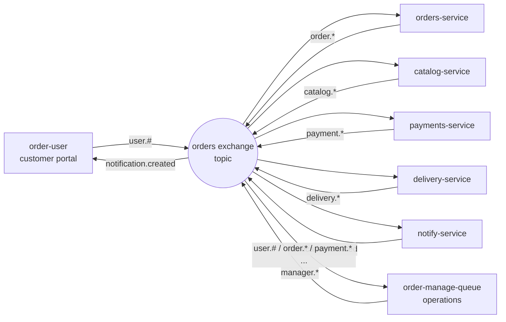

# Orders Lab · Microservices Architecture

A runnable **event-driven microservices architecture** laboratory inspired by the reference article in this repository. The domain is a restaurant group: customers place orders, operations monitors and replies, the catalog reserves stock, payment is simulated, and delivery is driven by events.

Everything runs locally with **Docker Compose + RabbitMQ + SQLite**. Each microservice is an independent project (Node.js 24, ESM) with its own database and support HTTP API, communicating asynchronously through queues.

> Repository: <https://github.com/fabiossena/microservice-architecture>

---

## What is running

| Component | Responsibility | Port |
|---|---|---|
| `order-user` | Customer portal. Independent tabs per user, order actions, inbound/outbound messages with timestamps. | 8081 |
| `order-manage-queue` | Operations center. Receives customer actions, supports approve/cancel/refund/dispatch/restock, and provides one message form per customer with a 10s auto-refresh. | 8082 |
| `orders-service` | Owner of the order lifecycle. | 8091 |
| `payments-service` | Simulated payment acquirer with an approval limit. | 8092 |
| `delivery-service` | Courier assignment, dispatch, and delivery completion. | 8093 |
| `catalog-service` | Catalog, stock, and per-order reservations. | 8094 |
| `notify-service` | Turns domain events into per-user notifications. | 8095 |
| `api-gateway` | Dashboard, proxy for the views, and aggregated health. | 8080 |
| RabbitMQ | `orders` topic exchange, durable queues, and management UI. | 5672 / 15672 |

**Shortcuts**

- Dashboard: <http://localhost:8070>
- Customer portal: <http://localhost:8070/user/> or <http://localhost:8071>
- Operations center: <http://localhost:8070/manage/> or <http://localhost:8072>
- RabbitMQ Management: <http://localhost:15672> (`orders` / `orders123`)

External ports `8070–8072` were chosen to avoid conflicts with other local services that commonly occupy `8080–8082`. The internal container ports remain `8080`, `8081`, and `8082`.

---

## Screens

| Customer portal | Operations center |
|---|---|
|  |  |


---

## Getting started

Prerequisite: Docker Desktop running (Docker Compose v2+).

```powershell
# from the project root
Copy-Item .env.example .env
docker compose up -d --build
docker compose ps
```

The first start pulls images and installs dependencies for each service. Once all containers are `healthy`:

1. Open the customer portal as **Alice**: <http://localhost:8071/?user=Alice>
2. Open another window as **Bob**: <http://localhost:8071/?user=Bob>
3. Open the operations center: <http://localhost:8072>
4. Place an order in each customer window.
5. In operations, use the per-customer columns at the top to send messages, or click **Use this context** on a customer message for the detailed queue.
6. Watch notifications arrive in each tab with message text and timestamps.
7. Inspect queues and messages at <http://localhost:15672>.

Orders are approved automatically after ~12s (`AUTO_APPROVE_MS`) so the simulation does not stall; operations can approve or cancel earlier.

Follow the logs:

```powershell
docker compose logs -f orders-service catalog-service payments-service delivery-service notify-service
```

Stop the stack (keeping data) or reset everything:

```powershell
docker compose down
docker compose down -v   # also removes SQLite and RabbitMQ volumes
```

All monetary values are displayed in **USD** (`$`) using `en-US` formatting.

---

## How the flow works



### Main choreography


- **Customer** publishes commands/actions (`user.#`) and displays inbound `notification.created` messages.
- **Operations** receives all `user.#` actions and domain events, and publishes `manager.*` commands.
- **Domain services** react only to the events they depend on and publish facts (`order.*`, `catalog.*`, `payment.*`, `delivery.*`).
- **notify-service** translates events into notifications, keeping the views decoupled from business rules.

The catalog reserves stock **before** payment. Payment approves **before** delivery. Cancellations trigger compensations: `catalog.released`, `payment.refunded`, and `delivery.cancelled`.

Full details in [`docs/architecture.md`](docs/architecture.md) and [`docs/event-catalog.md`](docs/event-catalog.md).

---

## Repository structure

```
microservice-architecture/
├── docker-compose.yml
├── .env.example
├── api-gateway/                 # dashboard + reverse proxy for the views
├── order-user/                  # customer view (SSE + SQLite)
├── order-manage-queue/          # operations view (SSE + SQLite)
├── orders-service/              # Order aggregate
├── catalog-service/             # catalog and reservations
├── payments-service/            # simulated payment
├── delivery-service/            # simulated delivery
├── notify-service/              # notifications
├── docs/
│   ├── architecture.md
│   ├── event-catalog.md
│   ├── operations.md
│   └── images/
├── scripts/
│   └── smoke-test.mjs
├── platform-infra/              # local/production infrastructure notes
└── .github/workflows/ci.yml
```

Each service follows a simple separation inspired by Clean Architecture:

```
<service>/
├── src/
│   ├── api/             # support HTTP (health, queries)
│   ├── application/     # use cases / event handlers
│   ├── domain/          # pure business rules
│   ├── infrastructure/  # AMQP broker and SQLite
│   ├── config.js
│   └── index.js
├── test/
├── Dockerfile
├── package.json
└── README.md
```

The views keep presentation under `public/` and broker/database integration under `src/`.

---

## Message model

Every event uses the same envelope:

```json
{
  "id": "uuid",
  "type": "order.confirmed",
  "source": "orders-service",
  "occurredAt": "2026-11-10T14:32:00.000Z",
  "correlationId": "order-id-or-uuid",
  "user": "Alice",
  "message": "Order #a1b2c3d4 approved. Total: $91.80.",
  "payload": { "orderId": "a1b2c3d4-...", "total": 91.8 }
}
```

- The **routing key** is the `type` itself.
- Messages are persistent and queues are durable.
- Consumers use manual `ack` and `prefetch=10`.
- Each service stores processed `event_id` values in SQLite for basic idempotency.
- The views persist all inbound/outbound traffic in SQLite with `occurred_at` and `recorded_at`.

### RabbitMQ topology

Exchange: `orders` (topic, durable).

| Queue | Main bindings |
|---|---|
| `orders-service.events` | `user.order.place`, `user.order.cancel`, `user.order.status`, `manager.order.approve`, `manager.order.cancel`, `catalog.rejected`, `payment.approved`, `payment.declined`, `delivery.delivered` |
| `catalog-service.events` | `order.confirmed`, `order.cancelled`, `user.catalog.check`, `manager.catalog.restock` |
| `payments-service.events` | `catalog.reserved`, `order.cancelled`, `user.payment.retry`, `manager.payment.refund` |
| `delivery-service.events` | `payment.approved`, `order.cancelled`, `user.delivery.eta`, `manager.delivery.dispatch` |
| `notify-service.events` | `order.*`, `catalog.*`, `payment.*`, `delivery.*`, `manager.reply`, `manager.broadcast` |
| `order-user.notifications` | `notification.created` |
| `order-manage.inbox` | `user.#`, `order.*`, `catalog.*`, `payment.*`, `delivery.*` |

---

## Design decisions

- **Choreography instead of a central orchestrator.** Each service knows only the events it consumes and publishes. Coupling happens through the event contract.
- **One database per service.** Local SQLite (one file per service) simulates data autonomy; no service reads another service's database. In production, replace it with PostgreSQL per service.
- **Decoupled views.** The customer does not call catalog/payment directly. It publishes actions and receives notifications. Operations publishes commands that are translated into domain events.
- **Saga through compensation.** Cancellation releases stock, refunds payment, and cancels delivery.
- **Notification as a service.** notify-service centralizes the user-facing message format and allows adding email/push/WebSocket without touching the other services.
- **SSE + SQLite in the views.** Real-time updates with no extra dependencies; history survives a page reload.
- **Configurable automatic approval.** Keeps the lab flowing even without operator interaction.

### Known limitations (and next steps)

This is a runnable lab, not a production system. To evolve it:

1. **Transactional outbox** in services to publish events without losing data between commit and publish.
2. **Dead-letter queues + retry with backoff**; today messages that fail are dropped (`nack` without requeue).
3. **Idempotency by business key** in addition to `event_id` (for example, unique `order_id` on reservations).
4. **Authentication/authorization** at the gateway and APIs; the environment is currently open.
5. **Versioned contracts** (JSON Schema/Avro/CloudEvents) and contract tests.
6. **Distributed observability**: OpenTelemetry, Jaeger, Prometheus, Grafana, and logs correlated by `correlationId`.
7. **PostgreSQL + migrations** and real transactions per service.
8. **Kubernetes/Helm**, secrets, TLS, HPA, and resilience policies.
9. **Testcontainers** for full-flow integration tests.
10. **Production UI** with authentication, profiles, paginated history, and i18n.

---

## Development and tests

Each service is an independent Node.js project:

```powershell
cd orders-service
npm install
npm test
npm start   # requires RabbitMQ locally on localhost:5672
```

> Node.js 24+ is required because of the built-in `node:sqlite` module (no external native dependency).

Run all domain tests:

```powershell
foreach ($svc in 'orders-service','catalog-service','payments-service','delivery-service','notify-service') {
  Push-Location $svc
  npm test
  Pop-Location
}
```

The tests cover pure rules (total calculation, stock, payment decision, ETA, notification routing). The distributed flow is validated through the UI and can be automated with Testcontainers.

### Full-flow smoke test

With the Compose stack running:

```powershell
node scripts/smoke-test.mjs
```

The script validates aggregated health, creates an order, approves it through operations, waits for the workflow to reach `delivered`, checks the state in orders/payments/delivery, sends an operations reply, and verifies it reaches the customer inbox. It requires Node.js 18+ (native `fetch`) and the default lab ports; override them with `GATEWAY_URL`, `ORDERS_URL`, `PAYMENTS_URL`, `DELIVERY_URL`, and `CATALOG_URL`.

---

## Publishing to GitHub

The expected remote is `https://github.com/fabiossena/microservice-architecture`.

```powershell
git init
git add .
git commit -m "feat: event-driven microservices lab with RabbitMQ, SQLite, and real-time UIs"
git branch -M main
git remote add origin https://github.com/fabiossena/microservice-architecture.git
git push -u origin main
```

If `gh` is authenticated, you can also create the repository with:

```powershell
gh repo create fabiossena/microservice-architecture --public --source . --remote origin --push
```

---

## License

MIT. See [`LICENSE`](LICENSE). Study project: feel free to adapt the architecture and domain.
