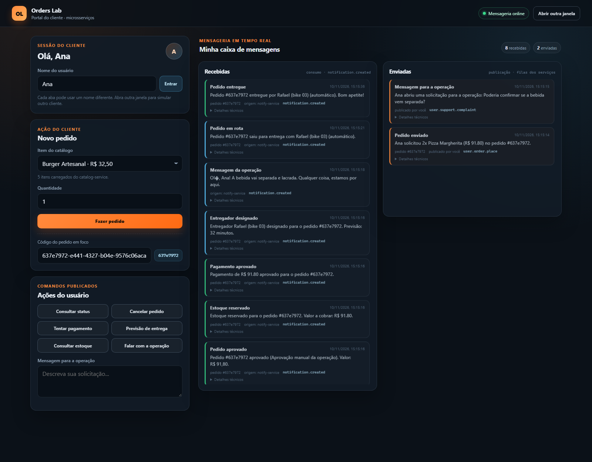
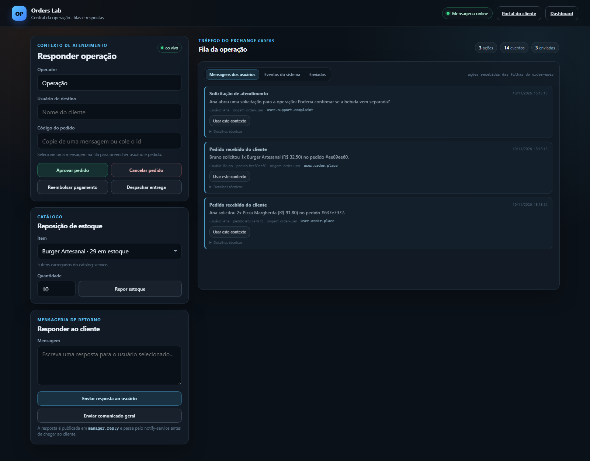
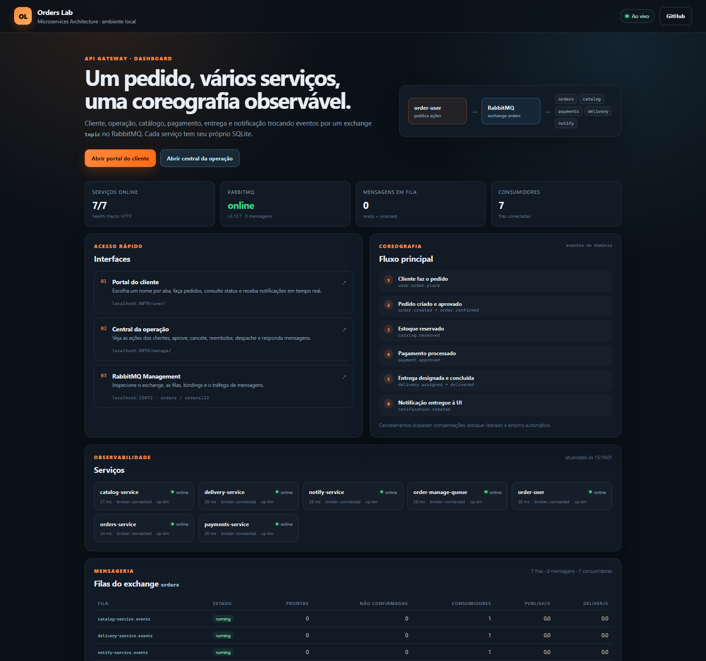
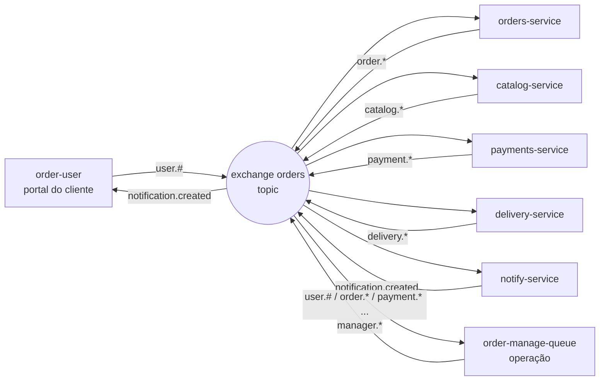
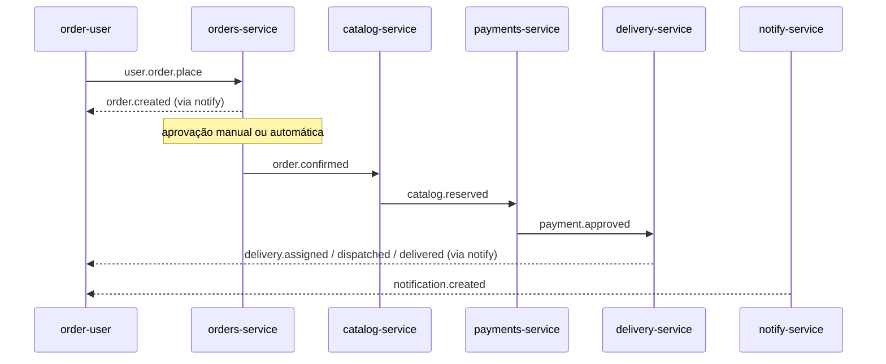

# Orders Lab · Microservices Architecture

Laboratório executável de **arquitetura de microsserviços orientada a eventos**, inspirado no artigo de referência do repositório. O domínio é um grupo de restaurantes: o cliente faz pedidos, a operação acompanha e responde, o catálogo reserva estoque, o pagamento é simulado e a entrega é orquestrada por eventos.

Tudo sobe localmente com **Docker Compose + RabbitMQ + SQLite**. Cada microsserviço é um projeto independente (Node.js 24, ESM), com API HTTP de apoio, banco próprio e comunicação assíncrona por filas.

> Repositório: <https://github.com/fabiossena/microservice-architecture>

---

## O que está rodando

| Componente | Papel | Porta |
|---|---|---|
| `order-user` | Portal do cliente. Abas independentes por usuário, ações de pedido, entrada/saída de mensagens com data/hora. | 8081 |
| `order-manage-queue` | Central da operação. Recebe ações dos clientes, permite aprovar/cancelar/reembolsar/despachar/repor e responder. | 8082 |
| `orders-service` | Dono do ciclo de vida do pedido. | 8091 |
| `payments-service` | Adquirente simulada, com limite de aprovação. | 8092 |
| `delivery-service` | Designação de entregador, despacho e conclusão. | 8093 |
| `catalog-service` | Catálogo, estoque e reservas por pedido. | 8094 |
| `notify-service` | Transforma eventos de domínio em notificações por usuário. | 8095 |
| `api-gateway` | Dashboard, proxy para as views e health agregado. | 8080 |
| RabbitMQ | Exchange `orders` (topic), filas duráveis e management UI. | 5672 / 15672 |

**Atalhos**

- Dashboard: <http://localhost:8070>
- Portal do cliente: <http://localhost:8070/user/> ou <http://localhost:8071>
- Central da operação: <http://localhost:8070/manage/> ou <http://localhost:8072>
- RabbitMQ Management: <http://localhost:15672> (`orders` / `orders123`)

As portas externas `8070–8072` foram escolhidas para evitar conflito com outros serviços locais que costumam ocupar `8080–8082`. As portas internas dos containers permanecem `8080`, `8081` e `8082`.

---

## Telas

| Portal do cliente | Central da operação |
|---|---|
|  |  |




---

## Começando

Pré-requisito: Docker Desktop em execução (Docker Compose v2+).

```powershell
# na raiz do projeto
Copy-Item .env.example .env
docker compose up -d --build
docker compose ps
```

A primeira subida baixa as imagens e instala as dependências de cada serviço. Quando todos estiverem `healthy`:

1. Abra o portal do cliente com **Ana** em uma janela: <http://localhost:8071/?user=Ana>
2. Abra outra janela com **Bruno**: <http://localhost:8071/?user=Bruno>
3. Abra a central da operação: <http://localhost:8072>
4. Em cada janela do cliente, faça um pedido.
5. Na operação, clique em **Usar este contexto** em uma mensagem de cliente e use os botões de resposta.
6. Observe as notificações chegando em cada aba, com mensagem e data/hora.
7. Inspecione filas e mensagens em <http://localhost:15672>.

O pedido é aprovado automaticamente após ~12s (`AUTO_APPROVE_MS`) para a simulação não travar; a operação pode aprovar/cancelar antes disso.

Para acompanhar os logs:

```powershell
docker compose logs -f orders-service catalog-service payments-service delivery-service notify-service
```

Para derrubar (mantendo dados) ou resetar tudo:

```powershell
docker compose down
docker compose down -v   # remove também os volumes SQLite e do RabbitMQ
```

---

## Como o fluxo funciona



### Coreografia principal



- **Cliente** publica comandos/ações (`user.#`) e exibe o que chega como `notification.created`.
- **Operação** recebe todas as ações `user.#` e os eventos de domínio, e publica comandos `manager.*`.
- **Serviços de domínio** reagem apenas aos eventos dos quais dependem e publicam fatos (`order.*`, `catalog.*`, `payment.*`, `delivery.*`).
- **notify-service** é o tradutor de eventos para notificações, mantendo as views desacopladas das regras de negócio.

O catálogo reserva o estoque **antes** do pagamento. O pagamento aprova **antes** da entrega. Cancelamentos disparam compensações: `catalog.released`, `payment.refunded` e `delivery.cancelled`.

Detalhes completos em [`docs/architecture.md`](docs/architecture.md) e [`docs/event-catalog.md`](docs/event-catalog.md).

---

## Estrutura do repositório

```
microservice-architecture/
├── docker-compose.yml
├── .env.example
├── api-gateway/                 # dashboard + proxy reverso das views
├── order-user/                  # view do cliente (SSE + SQLite)
├── order-manage-queue/          # view da operação (SSE + SQLite)
├── orders-service/              # agregado Order
├── catalog-service/             # catálogo e reservas
├── payments-service/            # pagamento simulado
├── delivery-service/            # entrega simulada
├── notify-service/              # notificações
├── docs/
│   ├── architecture.md
│   ├── event-catalog.md
│   ├── operations.md
│   └── images/
├── scripts/
│   └── smoke-test.mjs
├── platform-infra/              # notas de infraestrutura local/produção
└── .github/workflows/ci.yml
```

Cada serviço segue uma separação simples inspirada em Clean Architecture:

```
<servico>/
├── src/
│   ├── api/             # HTTP de apoio (health, consultas)
│   ├── application/     # casos de uso / handlers de eventos
│   ├── domain/          # regras puras
│   ├── infrastructure/  # broker AMQP e SQLite
│   ├── config.js
│   └── index.js
├── test/
├── Dockerfile
├── package.json
└── README.md
```

As views mantêm a camada de apresentação em `public/` e a integração com broker/banco em `src/`.

---

## Modelo de mensagem

Todos os eventos usam o mesmo envelope:

```json
{
  "id": "uuid",
  "type": "order.confirmed",
  "source": "orders-service",
  "occurredAt": "2026-11-10T14:32:00.000Z",
  "correlationId": "order-id-ou-uuid",
  "user": "Ana",
  "message": "Pedido #a1b2c3d4 aprovado. Valor: R$ 91,80.",
  "payload": { "orderId": "a1b2c3d4-...", "total": 91.8 }
}
```

- A **routing key** é o próprio `type`.
- Mensagens são persistentes e as filas são duráveis.
- Os consumidores usam `ack` manual e `prefetch=10`.
- Cada serviço registra `event_id` processado em SQLite para idempotência básica.
- As views gravam todo o tráfego de entrada/saída em SQLite, com `occurred_at` e `recorded_at`.

### Topologia RabbitMQ

Exchange: `orders` (topic, durável).

| Fila | Principais bindings |
|---|---|
| `orders-service.events` | `user.order.place`, `user.order.cancel`, `user.order.status`, `manager.order.approve`, `manager.order.cancel`, `catalog.rejected`, `payment.approved`, `payment.declined`, `delivery.delivered` |
| `catalog-service.events` | `order.confirmed`, `order.cancelled`, `user.catalog.check`, `manager.catalog.restock` |
| `payments-service.events` | `catalog.reserved`, `order.cancelled`, `user.payment.retry`, `manager.payment.refund` |
| `delivery-service.events` | `payment.approved`, `order.cancelled`, `user.delivery.eta`, `manager.delivery.dispatch` |
| `notify-service.events` | `order.*`, `catalog.*`, `payment.*`, `delivery.*`, `manager.reply`, `manager.broadcast` |
| `order-user.notifications` | `notification.created` |
| `order-manage.inbox` | `user.#`, `order.*`, `catalog.*`, `payment.*`, `delivery.*` |

---

## Decisões de design

- **Coreografia em vez de orquestrador central.** Cada serviço conhece apenas os eventos que consome e publica. O acoplamento é pelo contrato do evento.
- **Um banco por serviço.** SQLite local (um arquivo por serviço) simula a autonomia de dados; nenhum serviço lê o banco do outro. Em produção, troque por PostgreSQL por serviço.
- **Views desacopladas.** O cliente não fala diretamente com catálogo/pagamento. Ele publica ações e recebe notificações. A operação publica comandos que são traduzidos em eventos de domínio.
- **Saga por compensação.** Cancelamento libera estoque, estorna pagamento e cancela entrega.
- **Notificação como serviço.** O notify-service centraliza o formato de mensagem ao usuário e permite adicionar e-mail/push/WebSocket sem tocar nos demais serviços.
- **SSE + SQLite nas views.** Atualização em tempo real sem dependências extras; o histórico permanece após recarregar a página.
- **Aprovação automática configurável.** Mantém o laboratório fluindo mesmo sem interação da operação.

### Limitações conscientes (e próximos passos)

Este é um laboratório executável, não um sistema de produção. Para evoluir:

1. **Transactional outbox** nos serviços para publicar eventos sem perder dados em falhas entre commit e publish.
2. **Dead-letter queues + retry com backoff**; hoje mensagens com erro são descartadas (`nack` sem requeue).
3. **Idempotência por chave de negócio** além do `event_id` (ex.: `order_id` único nas reservas).
4. **Autenticação/autorização** no gateway e nas APIs; hoje o ambiente é aberto.
5. **Contratos versionados** (JSON Schema/Avro/CloudEvents) e testes de contrato.
6. **Observabilidade distribuída**: OpenTelemetry, Jaeger, Prometheus, Grafana, logs correlacionados por `correlationId`.
7. **PostgreSQL + migrations** e transações reais por serviço.
8. **Kubernetes/Helm**, secrets, TLS, HPA e políticas de resiliência.
9. **Testcontainers** para testes de integração do fluxo completo.
10. **UI de produção** com autenticação, perfil, histórico paginado e i18n.

---

## Desenvolvimento e testes

Cada serviço é um projeto Node.js independente:

```powershell
cd orders-service
npm install
npm test
npm start   # requer RabbitMQ local em localhost:5672
```

> Node.js 24+ é necessário por causa do módulo nativo `node:sqlite` (sem dependência nativa externa).

Rodar todos os testes de domínio:

```powershell
foreach ($svc in 'orders-service','catalog-service','payments-service','delivery-service','notify-service') {
  Push-Location $svc
  npm test
  Pop-Location
}
```

Os testes cobrem regras puras (cálculo de total, estoque, decisão de pagamento, ETA, roteamento de notificações). O fluxo distribuído é validado manualmente pela UI e pode ser automatizado com Testcontainers.

### Smoke test do fluxo completo

Com o Compose no ar, execute:

```powershell
node scripts/smoke-test.mjs
```

O script valida health agregado, cria um pedido, aprova pela operação, aguarda a coreografia até `delivered`, confere os estados em orders/payments/delivery, envia uma resposta da operação e verifica a chegada na caixa do cliente. Requer Node.js 18+ (usa `fetch` nativo) e as portas padrão do laboratório; é possível sobrescrever com `GATEWAY_URL`, `ORDERS_URL`, `PAYMENTS_URL`, `DELIVERY_URL` e `CATALOG_URL`.

---

## Publicação no GitHub

O repositório remoto esperado é `https://github.com/fabiossena/microservice-architecture`.

```powershell
git init
git add .
git commit -m "feat: laboratório de microsserviços orientado a eventos"
git branch -M main
git remote add origin https://github.com/fabiossena/microservice-architecture.git
git push -u origin main
```

Se o `gh` estiver autenticado, também é possível criar o repositório com:

```powershell
gh repo create fabiossena/microservice-architecture --public --source . --remote origin --push
```

---

## Licença

MIT. Consulte [LICENSE](LICENSE). Projeto de estudo: sinta-se livre para adaptar a arquitetura e o domínio.
