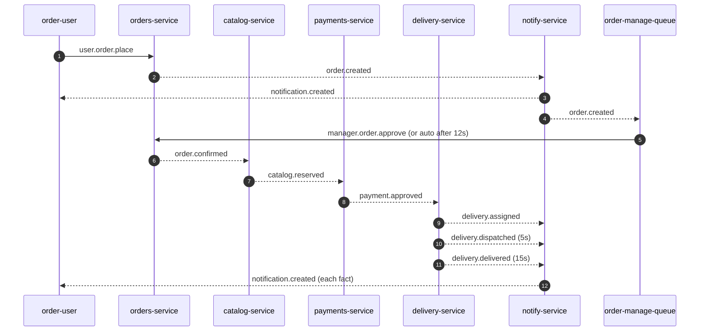
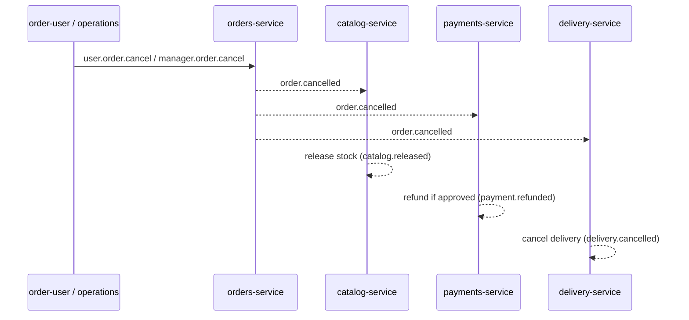
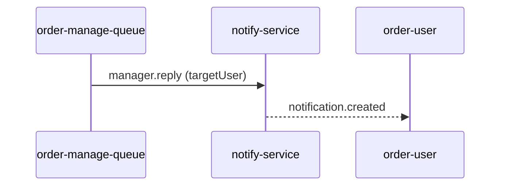

# Architecture

## Context

The domain is a restaurant group with autonomous services: orders, catalog, payments, delivery, and notifications. The two views (`order-user` and `order-manage-queue`) represent the customer and operations.

The goal is to demonstrate, in a runnable form, the central points of the reference article:

- autonomous services with independent databases and deployment;
- asynchronous communication through APIs, messaging, and events;
- choreographed saga with compensations;
- minimal observability (health, queues, message history);
- a possible evolution path from a modular monolith to extracted services.

## Service boundaries

| Service | Aggregate / responsibility | Database | Does not |
|---|---|---|---|
| orders-service | Order lifecycle | `orders.db` | Charge or deliver |
| catalog-service | Product, price, stock, and reservation | `catalog.db` | Know about payment |
| payments-service | Simulated charge and refund | `payments.db` | Change stock |
| delivery-service | Courier, ETA, dispatch | `deliveries.db` | Approve payment |
| notify-service | Notification format and delivery | `notifications.db` | Decide business rules |
| order-user | Customer interface and message log | `order-user.db` | Access domain databases |
| order-manage-queue | Operations interface and message log | `order-manage.db` | Access domain databases |

No service reads another service's database. Integration happens exclusively through support HTTP (health/catalog in the views) or the `orders` exchange.

## Integration style

- **Commands** arrive from outside the domain: `user.#` (customer) and `manager.*` (operations). They are intents.
- **Domain events** are facts published by their owners: `order.*`, `catalog.*`, `payment.*`, `delivery.*`.
- **Notifications** translate events for the user: `notification.created`.
- The routing key is the event type. The exchange is a `topic` exchange, enabling wildcard evolution (`order.*`).
- The lab uses **one RabbitMQ broker** with one `orders` exchange and seven durable queues. Queues are passive; the broker routes copies of each event to matching queues. There is no broker per service or per queue.

## Happy path



Chosen consistency order:

1. The order starts pending.
2. Human or automatic approval publishes `order.confirmed`.
3. The catalog reserves stock (`catalog.reserved`). If stock is missing, `catalog.rejected` ends the flow without charging.
4. Payment is processed only after the reservation (`catalog.reserved -> payment.approved`).
5. Delivery is created only after payment (`payment.approved -> delivery.assigned`).
6. A notification is produced for every relevant fact.

This sequence avoids charging for an order without stock and avoids delivering without payment. It is a choreographed saga; there is no distributed transaction.

## Compensations

### Cancellation



If the order was already delivered, cancellation is rejected with `order.cancel_rejected`.

### Stock restock

Operations publishes `manager.catalog.restock`; the catalog increments the balance and publishes `catalog.restocked` as a broadcast (`user = "*"`).

### Operations reply



Command replies (approve, cancel, etc.) are not notified directly by notify-service; the owning service publishes the resulting fact, and notify-service translates it. This keeps business rules in the correct service.

## Data

- SQLite in WAL mode, one file per service, named Docker volumes.
- Domain tables + `processed_events` for basic idempotency.
- The views store an immutable message log (`messages`) with direction, category, type, source, user, payload, `occurred_at`, and `recorded_at`.
- Notifications use the source `event_id` as the primary key, preventing duplicates.

### Condensed schema

```
orders(id, user, status, total, items, reason, created_at, updated_at)
catalog(sku, name, price, stock)
reservations(order_id, user, items, created_at)
payments(id, order_id, user, amount, status, method, reason, created_at, updated_at)
deliveries(id, order_id, user, status, courier, eta_minutes, created_at, updated_at)
notifications(id, user, source, title, message, severity, original_type, payload, occurred_at, created_at)
messages(...)  -- one copy per view
```

## Views

### order-user

- Identity per tab through `?user=Name` + `sessionStorage` (not `localStorage`, allowing tabs with different users).
- SSE (`/api/stream`) delivers events in real time.
- The inbound list shows only the tab's user and broadcasts (`*`).
- The outbound list shows published commands with their routing keys.
- The catalog is fetched over HTTP from `catalog-service`; there is a local fallback so the UI does not break.

### order-manage-queue

- Consumes `user.#` for the "Customer messages" tab and the remaining domain events for "System events".
- The top customer board renders one column per customer, each with its own message history, reply form, refresh button, and 10-second auto-refresh.
- "Use this context" fills the user and order from the selected message.
- Replies go through notify-service, ensuring the same delivery path as the customer.
- Restock and general announcements are broadcasts.

## API Gateway

The `api-gateway` is deliberately simple:

- health and queue dashboard;
- HTTP proxy for `/user/` and `/manage/`, preserving SSE;
- per-service health aggregation.

It is not a production API Gateway: it has no authentication, rate limiting, TLS, circuit breaker, cache, or declarative routing.

## Failure and resilience

What exists today:

- automatic AMQP client reconnection;
- durable queues and messages;
- idempotency by `event_id`;
- compensations;
- health checks and `restart: unless-stopped`;
- short HTTP timeouts in the views;
- SSE with automatic browser reconnection.

What is missing for production:

- transactional outbox;
- DLQ and retry with backoff;
- per-aggregate locking/serialization;
- distributed tracing;
- schema registry and versioning;
- authentication and authorization;
- contract and chaos tests.

## Why there is no distributed transaction

Sagas trade atomicity for eventual consistency. Each service records its state and publishes facts. If a step fails, a compensating event is emitted. The system is eventually consistent, not immediately consistent. That trade-off is the operational cost mentioned in the article and is exactly what this lab makes visible.
