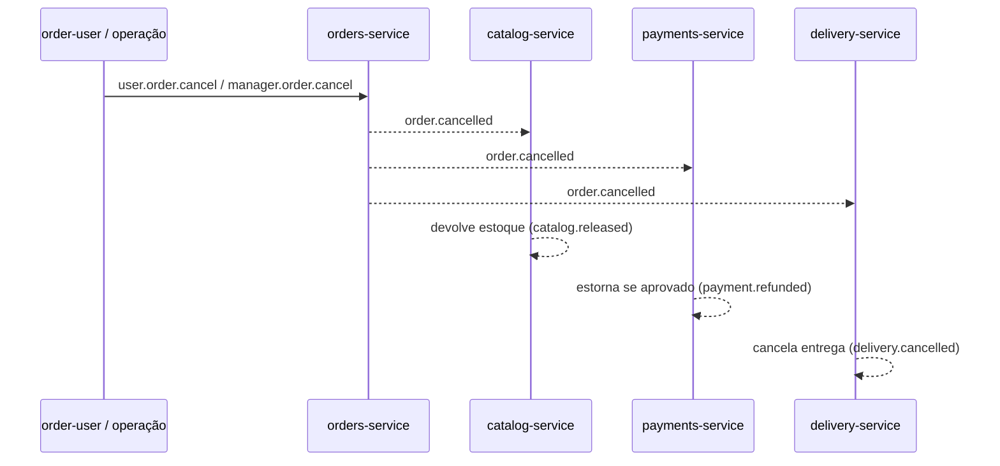
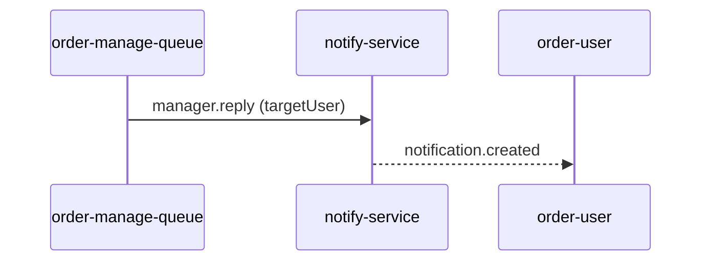

# Arquitetura

## Contexto

O domínio é um grupo de restaurantes com serviços autônomos: pedidos, catálogo, pagamentos, entrega e notificações. As duas views (`order-user` e `order-manage-queue`) representam, respectivamente, o cliente e a operação.

O objetivo é demonstrar, de forma executável, os pontos centrais do artigo:

- serviços autônomos, com banco e deploy independentes;
- comunicação assíncrona por APIs/mensageria/eventos;
- coreografia de uma saga com compensações;
- observabilidade mínima (health, filas, histórico de mensagens);
- evolução possível de um monólito modular para extração de serviços.

## Fronteiras dos serviços

| Serviço | Agregado / responsabilidade | Banco | Não faz |
|---|---|---|---|
| orders-service | Ciclo de vida do pedido | `orders.db` | Não cobra nem entrega |
| catalog-service | Produto, preço, estoque e reserva | `catalog.db` | Não conhece pagamento |
| payments-service | Cobrança e estorno simulados | `payments.db` | Não altera estoque |
| delivery-service | Entregador, ETA, despacho | `deliveries.db` | Não aprova pagamento |
| notify-service | Preferência e entrega de notificação | `notifications.db` | Não decide regra de negócio |
| order-user | Interface e log de mensagens do cliente | `order-user.db` | Não acessa bancos de domínio |
| order-manage-queue | Interface e log de mensagens da operação | `order-manage.db` | Não acessa bancos de domínio |

Nenhum serviço lê o banco de outro. A integração ocorre exclusivamente por HTTP de apoio (health/catálogo na view) ou pelo exchange `orders`.

## Estilo de integração

- **Comandos** chegam de fora do domínio: `user.#` (cliente) e `manager.*` (operação). São intenções.
- **Eventos de domínio** são fatos publicados pelos donos: `order.*`, `catalog.*`, `payment.*`, `delivery.*`.
- **Notificações** são a tradução de eventos para o usuário: `notification.created`.
- A routing key é o tipo do evento. O exchange é `topic` e permite evolução com wildcards (`order.*`).

## Fluxo feliz


Ordem de consistência escolhida:

1. O pedido nasce pendente.
2. Aprovação humana ou automática publica `order.confirmed`.
3. Catálogo reserva o estoque (`catalog.reserved`). Se faltar, `catalog.rejected` encerra o fluxo sem cobrança.
4. Pagamento só é processado após a reserva (`catalog.reserved -> payment.approved`).
5. Entrega só é criada após o pagamento (`payment.approved -> delivery.assigned`).
6. Notificação é produzida para cada fato relevante.

Essa sequência evita cobrar um pedido sem estoque e evita entregar sem pagamento. É uma saga por coreografia; não existe transação distribuída.

## Compensações

### Cancelamento



Se o pedido já foi entregue, o cancelamento é recusado com `order.cancel_rejected`.

### Reposição de estoque

A operação publica `manager.catalog.restock`; o catálogo incrementa o saldo e publica `catalog.restocked` como broadcast (`user = "*"`).

### Resposta da operação



Respostas de comando (aprovar, cancelar etc.) não são notificadas diretamente pelo notify; o serviço dono publica o fato resultante e o notify traduz. Isso mantém a regra de negócio no serviço correto.

## Dados

- SQLite em modo WAL, um arquivo por serviço, volumes Docker nomeados.
- Tabelas de domínio + `processed_events` para idempotência básica.
- As views armazenam um log imutável de mensagens (`messages`) com direção, categoria, tipo, origem, usuário, payload, `occurred_at` e `recorded_at`.
- Notificações usam o `event_id` de origem como chave primária, evitando duplicidade.

### Esquema resumido

```
orders(id, user, status, total, items, reason, created_at, updated_at)
catalog(sku, name, price, stock)
reservations(order_id, user, items, created_at)
payments(id, order_id, user, amount, status, method, reason, created_at, updated_at)
deliveries(id, order_id, user, status, courier, eta_minutes, created_at, updated_at)
notifications(id, user, source, title, message, severity, original_type, payload, occurred_at, created_at)
messages(...)  -- uma cópia em cada view
```

## Views

### order-user

- Identidade por aba via `?user=Nome` + `sessionStorage` (não usa `localStorage`, para permitir abas com usuários diferentes).
- SSE (`/api/stream`) entrega eventos em tempo real.
- A lista de entrada mostra apenas o usuário da aba e broadcasts (`*`).
- A lista de saída mostra os comandos publicados, com a routing key.
- O catálogo é consultado via HTTP no `catalog-service`; há fallback local para a UI não quebrar.

### order-manage-queue

- Consome `user.#` para a aba "Mensagens dos usuários" e o restante dos eventos de domínio para "Eventos do sistema".
- "Usar este contexto" preenche usuário e pedido a partir da mensagem selecionada.
- As respostas passam pelo notify-service, garantindo o mesmo caminho de entrega do cliente.
- Reposição de estoque e comunicado geral são broadcasts.

## API Gateway

O `api-gateway` é deliberadamente simples:

- dashboard de saúde e filas;
- proxy HTTP para `/user/` e `/manage/`, preservando SSE;
- agregação de health por serviço.

Não é um API Gateway de produção: não tem autenticação, rate limit, TLS, circuit breaker, cache ou roteamento declarativo.

## Falhas e resiliência

O que já existe:

- reconexão automática do cliente AMQP;
- filas e mensagens duráveis;
- idempotência por `event_id`;
- compensações;
- health checks e `restart: unless-stopped`;
- timeouts curtos nas chamadas HTTP das views;
- SSE com reconexão automática do navegador.

O que falta para produção:

- outbox transacional;
- DLQ e retry com backoff;
- lock/serialização por agregado;
- tracing distribuído;
- schema registry e versionamento;
- autenticação e autorização;
- testes de contrato e caos.

## Por que não há transação distribuída

Sagas trocam atomicidade por consistência eventual. Cada serviço registra seu estado e publica fatos. Se um passo falha, um evento compensatório é emitido. O sistema é consistente no final, não instantaneamente. Esse trade-off é o custo operacional citado no artigo e é exatamente o que este laboratório procura tornar visível.
